# huburton/os

*[English version](README.md)*

La plateforme web dont je me sers tous les jours, sur mon serveur et sur mon téléphone. La plupart du temps,
je passe par **Jarvis**, une discussion avec mes agents IA : je demande quelque chose, un hub Claude Code s'en
charge ou le confie à une session « ouvrière », et je suis ces sessions en direct dans **Tâches**. Autour :
mon planning (synchronisé dans les deux sens avec Google Agenda), ma médiathèque, mes projets, un brief du
matin et l'état de mes machines.

> Le Jarvis dont il est question ici est la discussion de cette plateforme. Ce n'est pas
> [jarvis](https://git.huburton.com/huburton/jarvis), mon assistant vocal, qui est un projet à part.

## La version que j'utilise au quotidien

Des captures de mon instance, remplie de données de démonstration : sessions, événements et médias inventés,
réponses simulées (d'où la mention *MAQUETTE*). L'interface est en français, ma langue de tous les jours.

**Jarvis : une discussion avec mes agents.** Les réponses peuvent contenir des tableaux, des listes à cocher,
des graphiques, des sections repliables, des cartes de documents et des questions avec boutons de réponse ;
le panneau latéral montre les quotas, les machines et les tâches en cours.

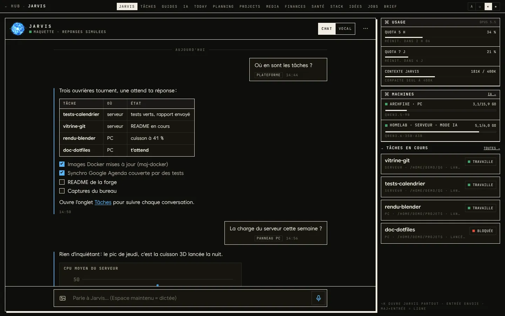

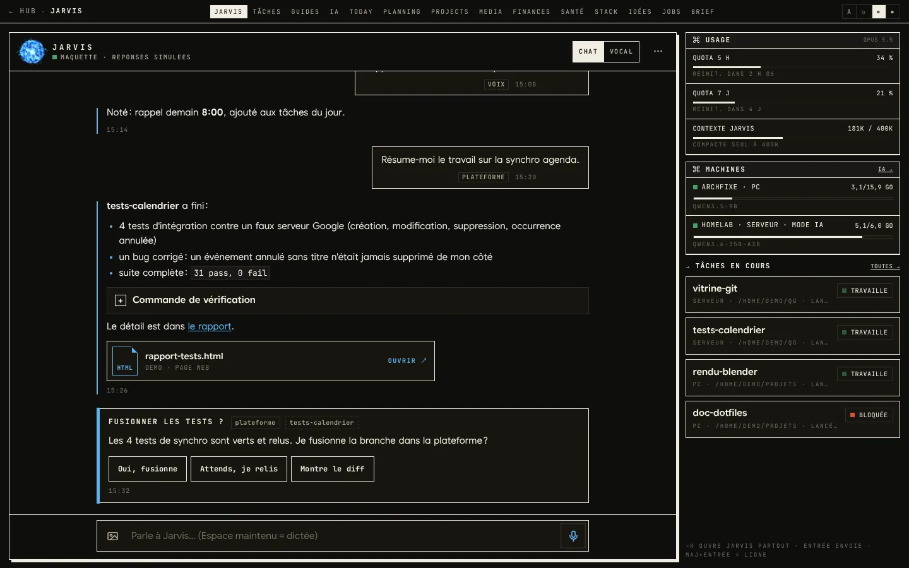

**Tâches : toutes les sessions Claude Code, sur le serveur et sur mon PC.** Les questions qui m'attendent
viennent en premier, regroupées par projet ; chaque session affiche son état et son dernier message.

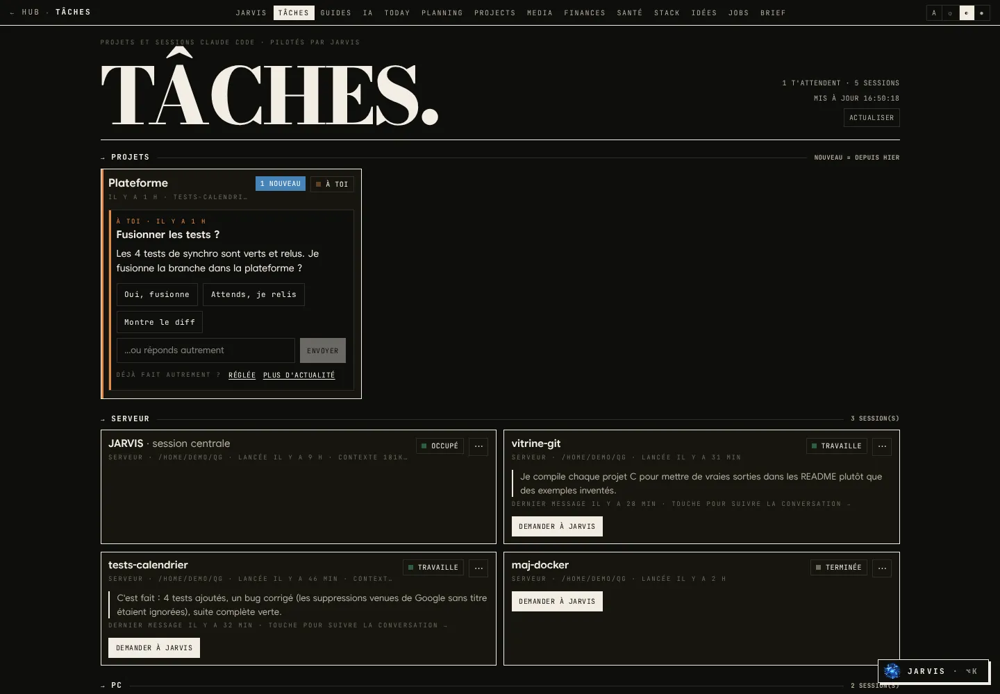

**Dans une session.** En ouvrant une session, on suit sa conversation au fil de l'eau : la consigne, chaque
appel d'outil sur une ligne (dépliable), les messages échangés avec le hub, et un champ pour lui répondre
via Jarvis.

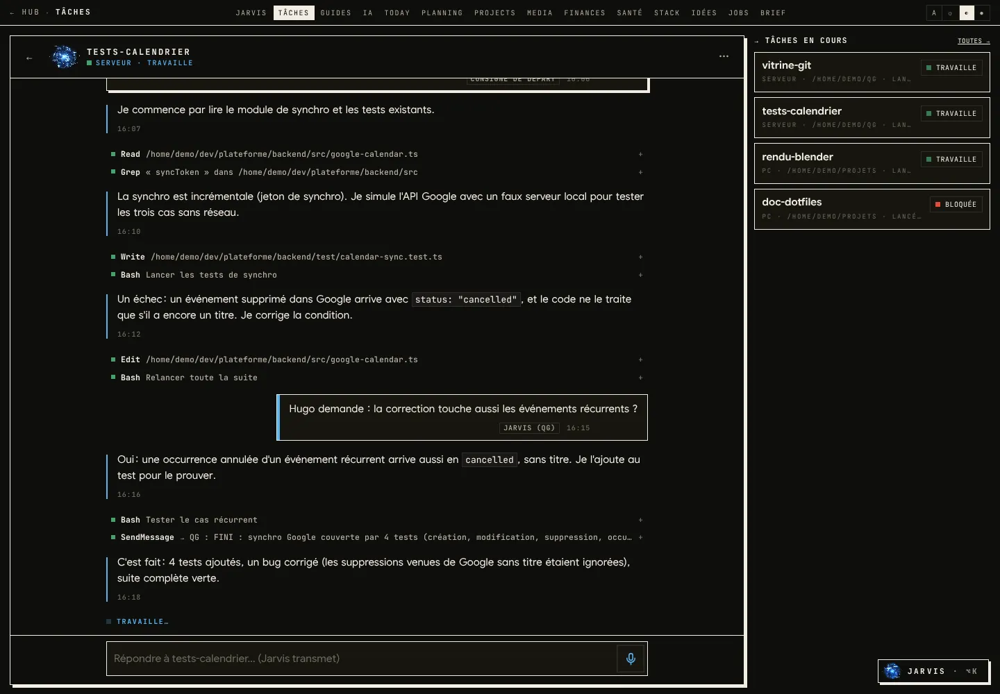

**Planning**, en vue semaine et en vue mois, synchronisé dans les deux sens avec Google Agenda.

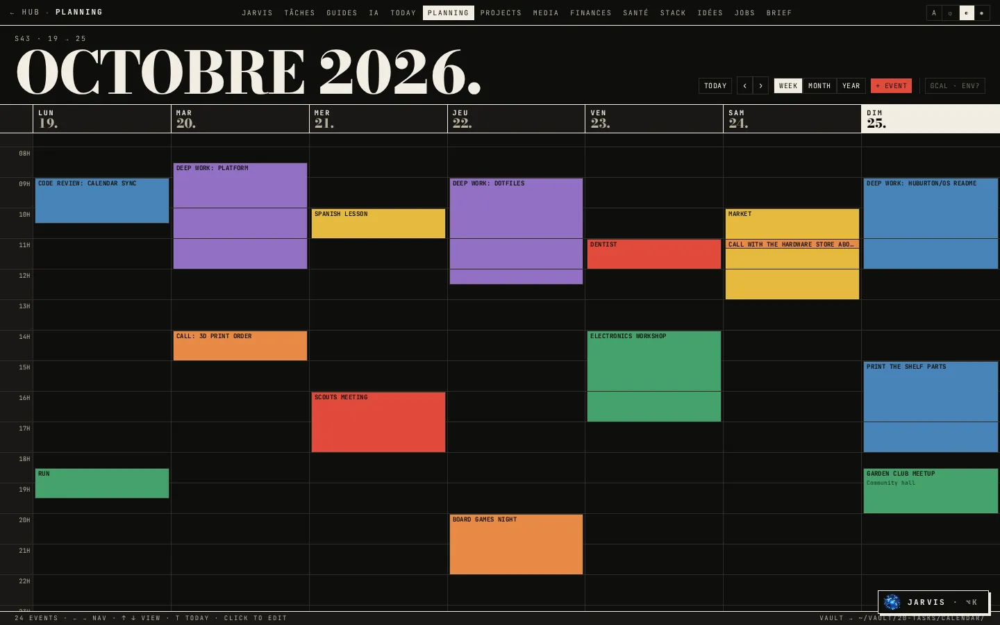

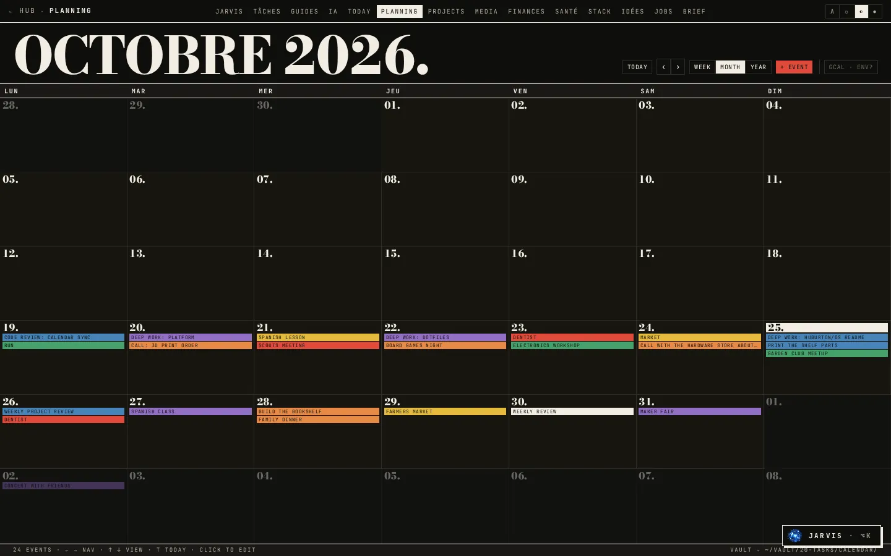

**Médias** : les films, séries, livres et jeux que je suis, avec ce qui est en cours, à voir et terminé
récemment.

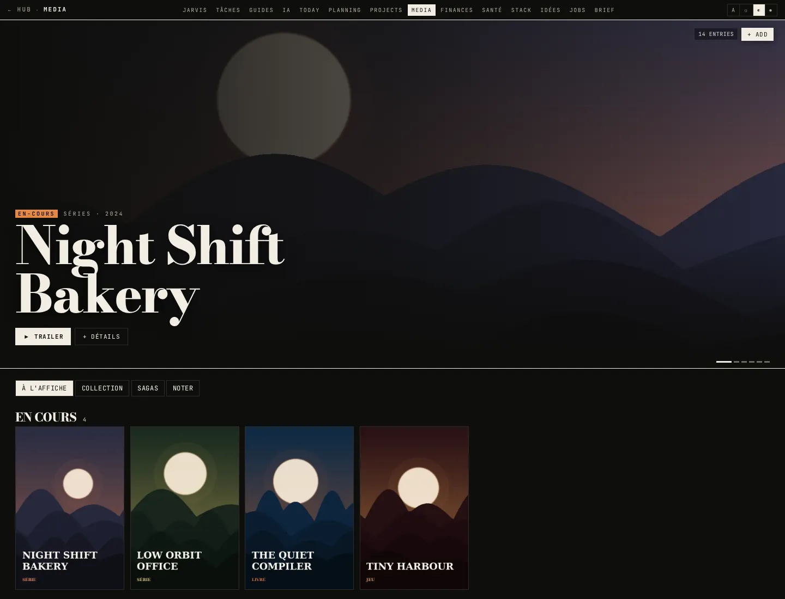

**Sur le téléphone** (PWA installable) : Jarvis, Tâches et Planning.

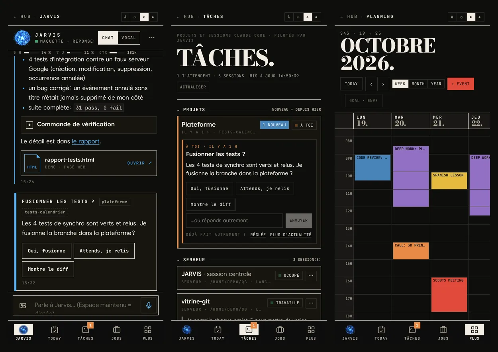

## Ce que contient ce dépôt

Ce dépôt est la partie ouverte de la plateforme, nettoyée pour tourner sans aucune de mes machines, de mes
clés ni de mes données : l'API, les pages planning, médias, projets, idées, IA locale et brief, et une démo
avec un jeu de données fictif. **Jarvis et Tâches n'y sont pas** : ils dépendent de services privés (le hub
Claude Code et son canal de notification, les sessions ouvrières). Le côté hub est décrit dans
[claude-qg](https://git.huburton.com/huburton/claude-qg).

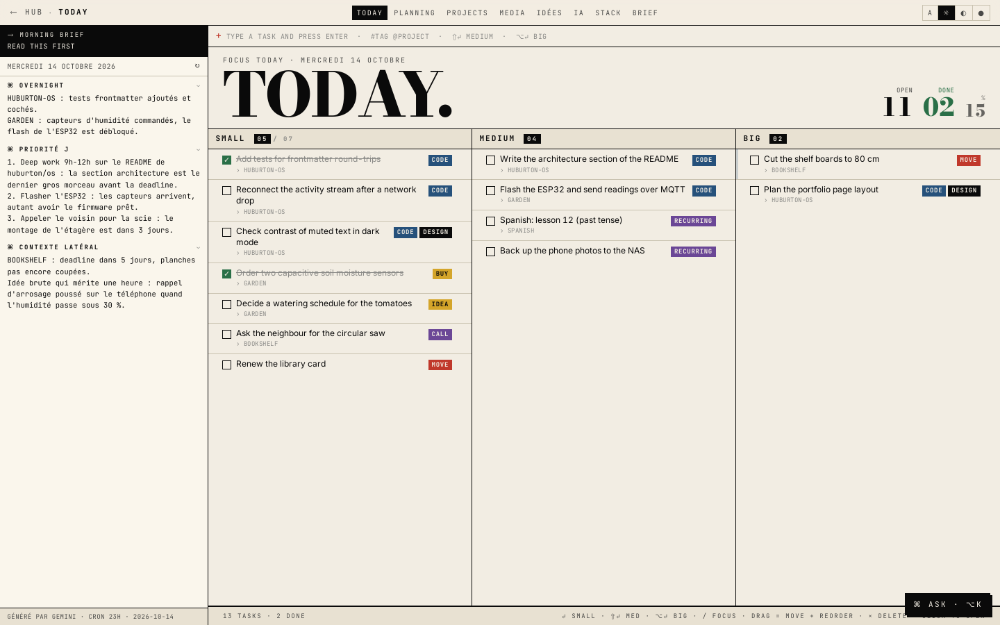

### Pages présentes dans ce dépôt

| Page | Ce qu'elle fait | Service externe |
| --- | --- | --- |
| **HUB** | Tâches prioritaires du jour, agenda d'aujourd'hui et de demain, statistiques du serveur, météo, état de l'IA locale | Open-Meteo (sans clé) |
| **TODAY** | Barre de saisie (`#tag @projet`, Maj+Entrée = moyenne, Alt+Entrée = grosse), tâches en colonnes petite / moyenne / grosse avec glisser-déposer, brief du matin | - |
| **PLANNING** | Calendrier semaine / mois / année, création et modification d'événements, **synchronisation bidirectionnelle avec Google Agenda** | Google Agenda (OAuth, facultatif) |
| **PROJECTS** | Notes de projet (statut, priorité, échéance, jalons) réunies avec les tâches qui les citent | - |
| **MEDIA** | Films, séries, livres, jeux ; vues par statut, note, collection et « sagas » TMDB, ajout en un clic depuis la recherche | TMDB (facultatif), Google Books, Wikipédia |
| **IDÉES** | Idées lues dans une note tableau Kanban d'Obsidian ; les nouvelles sont ajoutées dans sa première colonne | - |
| **IA** | État des routeurs llama.cpp sur deux machines (GPU, VRAM, modèles chargés), chargement / déchargement, chat en streaming | Vos propres serveurs llama.cpp (facultatif) |
| **ASK** | Un agent avec des outils (créer / lister / modifier des tâches, créer ou supprimer des événements en lot, ajouter un média, notifier…) | API Gemini (facultatif) |
| **BRIEF** | Flux d'activité en direct par **SSE** (les écritures de tâches, d'événements et de médias émettent des événements ; d'autres outils peuvent faire `POST /api/events`) | - |
| Brief du matin | Généré à 23 h à partir des tâches, événements, projets et idées, enregistré comme note dans le coffre, envoyé à 7 h 30 | Gemini + ntfy (facultatif) |

Aussi : PWA avec une page de repli hors ligne, thèmes clair / sombre / OLED, navigation au clavier
(`g t`, `g a`, `g p`…), une barre d'onglets en bas sur mobile. Les textes de l'interface sont en français
(c'est mon outil de tous les jours) ; le code et la documentation sont en anglais ou en français.

## Architecture

Les données sont stockées sous forme de notes Markdown avec un en-tête YAML (un fichier par tâche, événement,
projet ou média) : elles restent lisibles et modifiables en dehors de l'application. Une API Bun + Hono les
lit et les écrit.

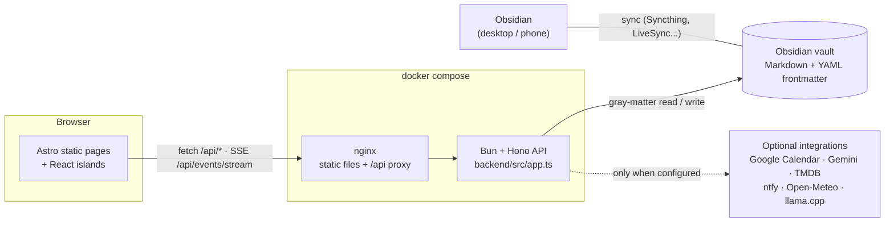

Correspondance entre une donnée et un fichier (voir [`demo-vault/`](demo-vault)) :

```markdown
<!-- 20-tasks/2026-10-14/2026-10-14-flash-the-esp32-042.md -->
---
type: "task"
id: "2026-10-14-flash-the-esp32-042"
title: "Flash the ESP32 and send readings over MQTT"
size: "medium"
tags: ["CODE"]
done: false
project: "GARDEN"
order: 1760430000000
created_at: "2026-10-14T07:00:00.000Z"
---

# Flash the ESP32 and send readings over MQTT
Free-form notes, links and images stay in the body and are shown in the task modal.
```

| Dossier du coffre | `type:` dans l'en-tête | Module |
| --- | --- | --- |
| `20-tasks/<date>/` | `task` | `backend/src/vault.ts` |
| `20-tasks/calendar/<yyyy-mm>/` | `event` | `backend/src/vault-calendar.ts` + `google-calendar.ts` |
| `30-projects/` | `project` | `backend/src/vault-project.ts` |
| `40-connaissances/médias/<category>/` | `media` | `backend/src/vault-media.ts`, `vault-media-write.ts` |
| `40-connaissances/idées/kanban-idées.md` | tableau du plugin Kanban | `backend/src/vault-ideas.ts` |
| `00-inbox/briefs/` | `brief` | `backend/src/morning-brief.ts` |

(Les noms de dossiers suivent mon propre coffre, en partie en français.)

Quelques choix de conception :

- **Ni index ni cache.** Chaque requête parcourt le dossier concerné et lit les en-têtes. Avec quelques
  centaines de notes, cela prend quelques millisecondes, et une modification faite dans Obsidian apparaît
  au rafraîchissement suivant, sans logique de synchronisation.
- **Un fichier par donnée**, nom de fichier = identifiant. Une mise à jour ne réécrit que l'en-tête et garde
  le corps Markdown. Les valeurs sont écrites comme des scalaires JSON (du YAML valide), si bien que les titres
  contenant `:` ou des guillemets survivent à l'aller-retour (testé).
- **La synchronisation Google Agenda** va dans les deux sens : les créations, modifications et suppressions
  locales sont envoyées, un planificateur récupère les changements toutes les 15 minutes, et un événement
  supprimé chez Google n'est retiré localement que si Google le confirme (`staleLocalEvents`, testé).
  Les événements sur une journée entière passent de la date de fin exclusive de Google à la date de fin
  inclusive du coffre.
- **Le front est statique** (Astro `output: static`) ; toutes les données vivantes arrivent par l'API, via
  des îlots React. nginx sert le build et relaie `/api` : pas de CORS en production.
- **Chaque intégration est facultative.** Sans clé, la fonction indique « non configurée » ; elle ne plante
  jamais.

## Démarrage rapide

### Démo (sans clé, sans appel réseau)

Nécessite [Bun](https://bun.sh) 1.3 ou plus.

```bash
bun install
bun run demo            # API on :4000, front on http://localhost:4321
bun run demo --reset    # start again from a fresh copy of demo-vault/
```

La démo copie [`demo-vault/`](demo-vault) dans `.demo-data/vault` (ignoré par git) en remplaçant `{{day}}`,
`{{day+2}}`… par de vraies dates, pour que l'agenda et le brief soient toujours à jour. Tout appel HTTP sortant
est coupé (`OFFLINE=1`), tout comme la liste des conteneurs Docker. Tout ce que vous créez dans l'interface
devient des fichiers Markdown dans `.demo-data/vault` ; ouvrez ce dossier dans Obsidian pour le voir se remplir.

### Docker

```bash
docker compose up --build   # http://localhost:8088
```

Même coffre de démo, copié dans un volume nommé au premier démarrage. Pour utiliser un vrai coffre, montez-le
sur `/vault`, retirez `DEMO_VAULT_TEMPLATE` et mettez `OFFLINE=0` (voir `docker-compose.yml`).

### Avec votre propre coffre

```bash
cp .env.example .env              # fill in what you want, leave the rest empty
VAULT_ROOT=/path/to/vault bun run dev:api
bun run dev                       # Vite proxies /api to http://localhost:4000
```

## Configuration

Toutes les variables sont facultatives. La liste complète est dans [`.env.example`](.env.example).

| Variable | Défaut | Effet |
| --- | --- | --- |
| `VAULT_ROOT` | `./vault` | Coffre utilisé comme base de données |
| `OFFLINE` | `0` | `1` coupe tout appel sortant (météo, affiches) |
| `TZ`, `TIME_ZONE` | `Europe/Brussels` | Dates locales, envois vers Google, horaire du brief |
| `PUBLIC_URL` | `http://localhost:4321` | Liens dans les notifications, redirection OAuth par défaut |
| `WEATHER_PLACE`, `WEATHER_LAT`, `WEATHER_LON` | Luxembourg | Lieu du widget météo |
| `GOOGLE_CLIENT_ID`, `GOOGLE_CLIENT_SECRET`, `GOOGLE_REDIRECT_URI` | - | Synchronisation Google Agenda (jeton stocké dans `<vault>/.config/`) |
| `GEMINI_API_KEY`, `GEMINI_MODEL` | -, `gemini-2.5-flash` | Agent ASK et brief du matin |
| `TMDB_API_KEY` ou `TMDB_READ_TOKEN` | - | Affiches, genres, sagas, bandes-annonces |
| `NTFY_URL`, `NTFY_TOPIC`, `NTFY_AUTH` | - | Notifications push |
| `AI_PC_*`, `AI_SERVER_*` | - | Machines LLM locales de la page IA |
| `HEALTHCHECK_SERVICES` | - | `Nom=https://url,...` testés sur la page STACK |
| `DOCKER_SOCKET` | `/var/run/docker.sock` | Liste des conteneurs sur la page STACK (`off` pour la couper) |
| `PUBLIC_HUB_LINKS` (au build) | liens de démo | Tuiles de services sur le HUB |

Sur chaque machine, la page IA attend un petit service d'état (`GET /status`, `POST /llm/load|unload`,
`POST /ai-mode`) à côté d'un routeur llama.cpp avec l'API compatible OpenAI. Ce service d'état est un script
personnel qui ne fait pas partie de ce dépôt ; sans lui, les deux machines apparaissent simplement hors ligne.

## Tests

```bash
bun run test            # 27 tests, backend only, against a temp copy of demo-vault/
bun run typecheck:api   # tsc on the API
bun run build           # static front build
```

Les tests couvrent l'écriture et la lecture des en-têtes (allers-retours avec des titres qui piègent le YAML,
dates, jalons), la gestion des dates (jour local ou UTC, changement de mois ou d'année, heure d'été), la règle
de suppression de la synchronisation Google, la lecture du brief, et les routes de l'API via `app.request()`
de Hono (CRUD des tâches jusqu'au fichier sur disque, filtre de plage du calendrier et normalisation des
entrées, idées Kanban, médias, brief, flux d'activité, intégrations désactivées). La CI lance les trois
mêmes étapes.

`bun run check` (`astro check`) signale encore environ 27 erreurs de typage dans les îlots React, héritées
du code d'origine ; elles n'empêchent pas le build et ne sont pas encore corrigées.

## Organisation du projet

```
backend/            Bun + Hono API
  src/app.ts        all routes (exported for tests)
  src/index.ts      entry point: demo vault, schedulers, server
  src/vault*.ts     one module per record type, on top of vault-fs.ts (walk, slug, frontmatter)
  src/google-calendar.ts, gemini.ts, morning-brief.ts, ai.ts, posters.ts, notify.ts, weather.ts ...
  test/             bun test suites + setup that copies demo-vault/ to a temp dir
demo-vault/         fictional vault (English, invented data)
src/                Astro pages, layout, React islands, global CSS (design tokens)
public/             PWA manifest, service worker, icons, offline page
scripts/demo.ts     starts API + front for the demo
docs/               screenshots, DESIGN.md (visual identity notes)
Dockerfile, backend/Dockerfile, nginx.conf, docker-compose.yml
```

## Captures de la démo de ce dépôt

| | |
| --- | --- |
| 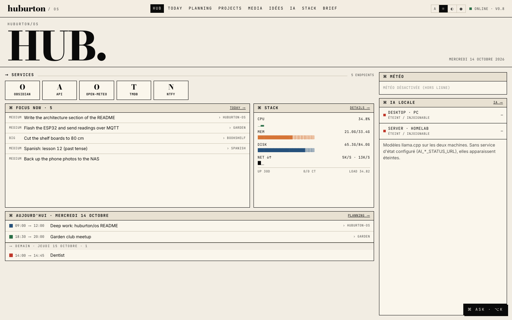 | 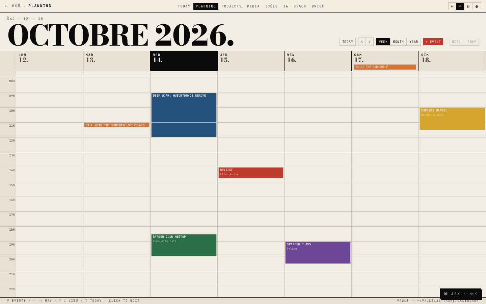 |
| 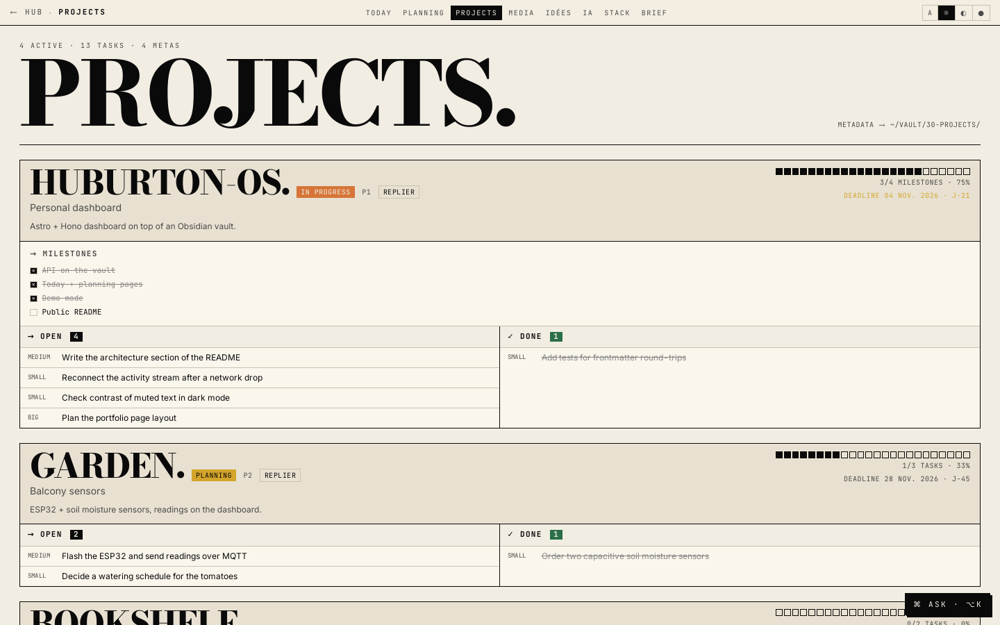 | 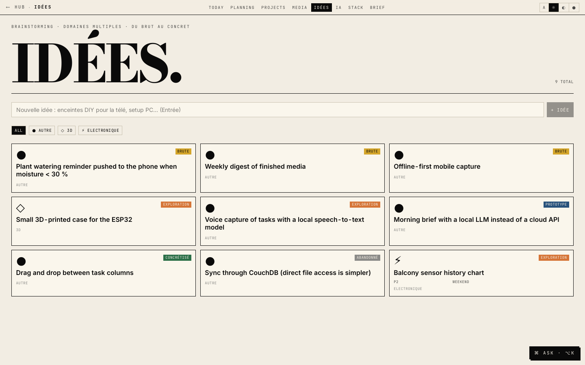 |

## État et limites

- C'est un outil personnel, utilisé tous les jours, pas un produit : un seul utilisateur, **aucune
  authentification** dans l'application elle-même. Chez moi, elle est derrière un reverse proxy avec un
  contrôle d'accès ; ne l'exposez pas telle quelle sur Internet.
- Le parcours du coffre est linéaire : très bien pour quelques centaines de notes, pas prévu pour des
  dizaines de milliers.
- Si la même note est modifiée en même temps dans Obsidian et dans le tableau de bord, la dernière écriture
  l'emporte.
- Certaines fonctions de mon instance ne sont pas incluses ici parce qu'elles dépendent de services privés :
  la discussion Jarvis et la page Tâches (voir plus haut), un outil de veille d'offres d'emploi, des pages
  finances et santé.
- Les textes de l'interface sont en français ; les noms de dossiers du coffre sont en partie en français.
- Construit avec des assistants de code IA (Claude Code), comme je me servirais d'une documentation ou de
  Stack Overflow : j'ai conçu le modèle de données et l'architecture, relu le code, et je peux expliquer
  chaque choix qui s'y trouve.

## Licence

MIT, voir [LICENSE](LICENSE).
