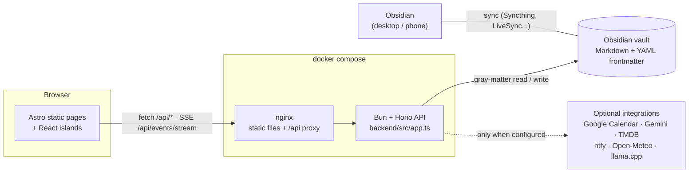

# huburton/os

A personal dashboard whose database is an Obsidian vault: tasks, calendar, projects, media and ideas are plain
Markdown notes with YAML frontmatter, a small Bun + Hono API reads and writes them, and an Astro front shows them.


## Why it exists

I already keep my notes, projects and reading lists in Obsidian. Every "productivity app" I tried meant a second
copy of the same data in someone else's database, out of sync within a week. So the idea here is the opposite:
**the vault is the database**. The dashboard never owns the data; it is a view and an editor on top of files I can
still open, grep, version and edit by hand in Obsidian. If the dashboard disappears tomorrow, nothing is lost.

It runs on my home server and on my phone (installable PWA). This repository is a cleaned-up copy of that
project with a fictional demo vault, so it can be run without any of my machines, keys or data.

## Features

| Page | What it does | External service |
| --- | --- | --- |
| **HUB** | Today's focus tasks, today/tomorrow agenda, server stats, weather, local AI status | Open-Meteo (no key) |
| **TODAY** | Capture bar (`#tag @project`, Shift+Enter = medium, Alt+Enter = big), tasks in small / medium / big columns with drag and drop, morning brief | - |
| **PLANNING** | Week / month / year calendar, create and edit events, **two-way Google Calendar sync** | Google Calendar (OAuth, optional) |
| **PROJECTS** | Project metadata notes (status, priority, deadline, milestones) merged with the tasks that reference them | - |
| **MEDIA** | Films, series, books, games; status, rating, collection and TMDB "sagas" views, one-click add from search | TMDB (optional), Google Books, Wikipedia |
| **IDÉES** | Ideas read from an Obsidian Kanban board note; new ideas are appended to its first column | - |
| **IA** | Status of llama.cpp routers on two machines (GPU, VRAM, loaded models), load/unload, streaming chat | Your own llama.cpp servers (optional) |
| **ASK** | An agent with tools (create/list/update tasks, bulk-create/delete events, add media, notify...) | Gemini API (optional) |
| **BRIEF** | Live activity stream over **SSE** (task, event and media writes emit events; other tools can `POST /api/events`) | - |
| Morning brief | Generated at 23:00 from tasks, events, projects and ideas, saved as a note in the vault, pushed at 07:30 | Gemini + ntfy (optional) |

Also: PWA with an offline fallback page, light / dark / OLED themes, keyboard navigation (`g t`, `g a`, `g p`...),
a mobile bottom bar. The UI copy is in French (it is my daily tool); code and docs are in English or French.

## Architecture



How a record maps to a file (see [`demo-vault/`](demo-vault)):

```markdown
<!-- 20-tasks/2026-10-14/2026-10-14-flash-the-esp32-042.md -->
---
type: "task"
id: "2026-10-14-flash-the-esp32-042"
title: "Flash the ESP32 and send readings over MQTT"
size: "medium"
tags: ["CODE"]
done: false
project: "GARDEN"
order: 1760430000000
created_at: "2026-10-14T07:00:00.000Z"
---

# Flash the ESP32 and send readings over MQTT
Free-form notes, links and images stay in the body and are shown in the task modal.
```

| Vault folder | `type:` in frontmatter | Module |
| --- | --- | --- |
| `20-tasks/<date>/` | `task` | `backend/src/vault.ts` |
| `20-tasks/calendar/<yyyy-mm>/` | `event` | `backend/src/vault-calendar.ts` + `google-calendar.ts` |
| `30-projects/` | `project` | `backend/src/vault-project.ts` |
| `40-connaissances/médias/<category>/` | `media` | `backend/src/vault-media.ts`, `vault-media-write.ts` |
| `40-connaissances/idées/kanban-idées.md` | Kanban plugin board | `backend/src/vault-ideas.ts` |
| `00-inbox/briefs/` | `brief` | `backend/src/morning-brief.ts` |

(Folder names follow my own vault, which is partly in French.)

Design choices worth knowing:

- **No index, no cache.** Every request walks the relevant folder and parses frontmatter. With a few hundred notes
  this takes milliseconds and means an edit made in Obsidian shows up on the next refresh, with no sync logic.
- **One file per record**, file name = id. Updates rewrite only the frontmatter and keep the Markdown body.
  Values are written as JSON scalars (valid YAML), so titles with `:` or quotes survive the round trip (tested).
- **Google Calendar sync** is two-way: local creates/edits/deletes are pushed, a scheduler pulls every 15 minutes,
  events deleted on Google are removed locally only when Google confirms it (`staleLocalEvents`, tested).
  All-day events convert between Google's exclusive end date and the vault's inclusive one.
- **The front is static** (Astro `output: static`); all live data comes from the API through React islands.
  nginx serves the build and proxies `/api`, so there is no CORS in production.
- **Every integration is optional.** A missing key makes the feature report "not configured"; it never crashes.

## Quick start

### Demo (no keys, no network calls)

Requires [Bun](https://bun.sh) 1.3+.

```bash
bun install
bun run demo            # API on :4000, front on http://localhost:4321
bun run demo --reset    # start again from a fresh copy of demo-vault/
```

The demo copies [`demo-vault/`](demo-vault) to `.demo-data/vault` (git-ignored), replacing `{{day}}`,
`{{day+2}}`... with real dates so the agenda and the brief always look current. All outbound HTTP is off
(`OFFLINE=1`), as is the Docker container list. Everything you create in the UI lands as Markdown files in
`.demo-data/vault`; open that folder in Obsidian to watch it happen.

### Docker

```bash
docker compose up --build   # http://localhost:8088
```

Same demo vault, copied into a named volume on first start. To use a real vault, bind-mount it on `/vault`,
remove `DEMO_VAULT_TEMPLATE` and set `OFFLINE=0` (see `docker-compose.yml`).

### Against your own vault

```bash
cp .env.example .env              # fill in what you want, leave the rest empty
VAULT_ROOT=/path/to/vault bun run dev:api
bun run dev                       # Vite proxies /api to http://localhost:4000
```

## Configuration

All variables are optional. See [`.env.example`](.env.example) for the full list.

| Variable | Default | Effect |
| --- | --- | --- |
| `VAULT_ROOT` | `./vault` | Vault used as the database |
| `OFFLINE` | `0` | `1` disables every outbound call (weather, posters) |
| `TZ`, `TIME_ZONE` | `Europe/Brussels` | Local dates, Google pushes, brief schedule |
| `PUBLIC_URL` | `http://localhost:4321` | Links in notifications, OAuth redirect default |
| `WEATHER_PLACE`, `WEATHER_LAT`, `WEATHER_LON` | Luxembourg | Weather widget location |
| `GOOGLE_CLIENT_ID`, `GOOGLE_CLIENT_SECRET`, `GOOGLE_REDIRECT_URI` | - | Google Calendar sync (token stored in `<vault>/.config/`) |
| `GEMINI_API_KEY`, `GEMINI_MODEL` | -, `gemini-2.5-flash` | ASK agent and morning brief |
| `TMDB_API_KEY` or `TMDB_READ_TOKEN` | - | Posters, genres, sagas, trailers |
| `NTFY_URL`, `NTFY_TOPIC`, `NTFY_AUTH` | - | Push notifications |
| `AI_PC_*`, `AI_SERVER_*` | - | Local LLM hosts on the IA page |
| `HEALTHCHECK_SERVICES` | - | `Name=https://url,...` pinged on the STACK page |
| `DOCKER_SOCKET` | `/var/run/docker.sock` | Container list on the STACK page (`off` to disable) |
| `PUBLIC_HUB_LINKS` (build time) | demo links | Service tiles on the HUB |

The IA page expects, on each machine, a small status service (`GET /status`, `POST /llm/load|unload`,
`POST /ai-mode`) next to a llama.cpp router with the OpenAI-compatible API. That status service is a personal
script and is not part of this repository; without it both machines simply show as offline.

## Tests

```bash
bun run test            # 27 tests, backend only, against a temp copy of demo-vault/
bun run typecheck:api   # tsc on the API
bun run build           # static front build
```

The tests cover frontmatter writing and parsing (round trips with YAML-hostile titles, dates, milestones),
date handling (local vs UTC day, month/year rollover, DST), the Google sync deletion rule, brief parsing, and
API routes through Hono's `app.request()` (tasks CRUD down to the file on disk, calendar range filter and input
normalisation, Kanban ideas, media, brief, activity stream, disabled integrations). CI runs the same three steps.

`bun run check` (`astro check`) still reports about 27 type errors in the React islands, inherited from the
original code; they do not affect the build and are not fixed yet.

## Project layout

```
backend/            Bun + Hono API
  src/app.ts        all routes (exported for tests)
  src/index.ts      entry point: demo vault, schedulers, server
  src/vault*.ts     one module per record type, on top of vault-fs.ts (walk, slug, frontmatter)
  src/google-calendar.ts, gemini.ts, morning-brief.ts, ai.ts, posters.ts, notify.ts, weather.ts ...
  test/             bun test suites + setup that copies demo-vault/ to a temp dir
demo-vault/         fictional vault (English, invented data)
src/                Astro pages, layout, React islands, global CSS (design tokens)
public/             PWA manifest, service worker, icons, offline page
scripts/demo.ts     starts API + front for the demo
docs/               screenshots, DESIGN.md (visual identity notes)
Dockerfile, backend/Dockerfile, nginx.conf, docker-compose.yml
```

## Screenshots

| | |
| --- | --- |
|  |  |
|  |  |

All screenshots use the demo vault.

## Status / limits

- This is a personal tool, used daily, not a product: single user, **no authentication** in the app itself.
  In my setup it sits behind a reverse proxy with an access gate; do not expose it to the internet as is.
- The vault walk is linear; fine for hundreds of notes, not designed for tens of thousands.
- Concurrent edits of the same note from Obsidian and the dashboard are last-write-wins.
- Some features of my running instance are not included here because they depend on private services:
  a voice/chat assistant, a job-offer scout, finance and health pages.
- The UI text is French; the vault folder names are partly French.
- Built with AI coding assistants (Claude Code), the same way I would use documentation and Stack Overflow:
  I designed the data model and the architecture, reviewed the code, and can explain every choice in it.

## Licence

MIT, see [LICENSE](LICENSE).
